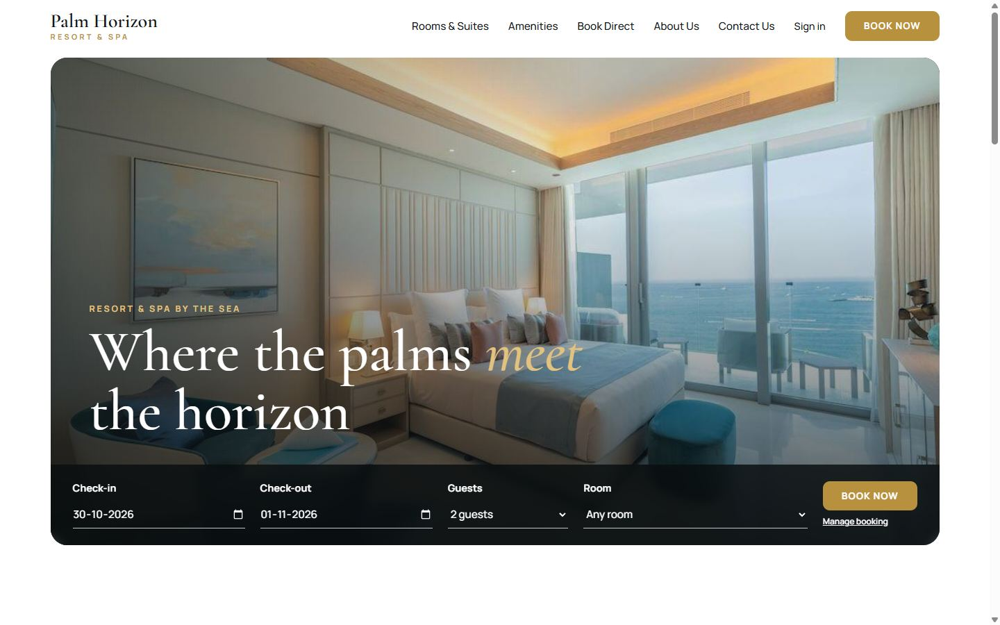
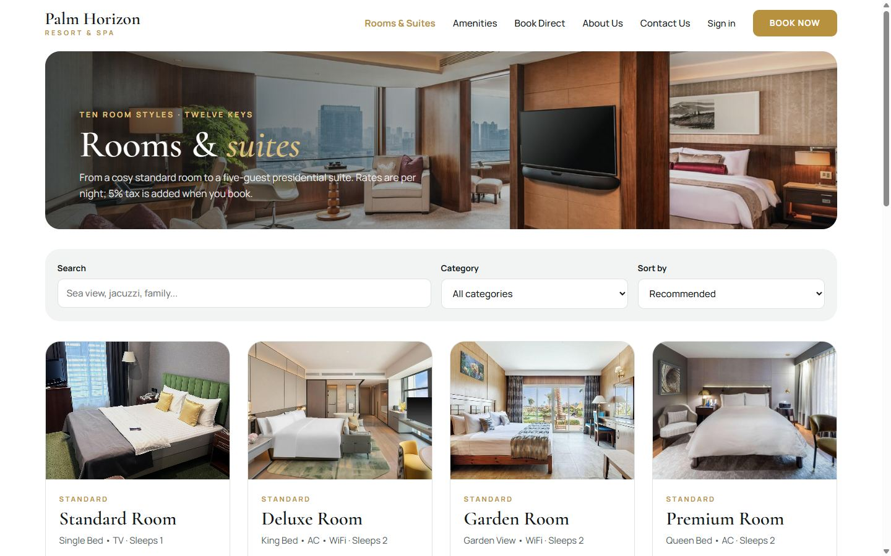
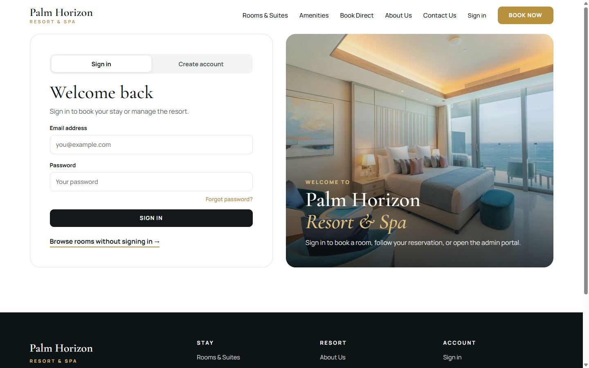
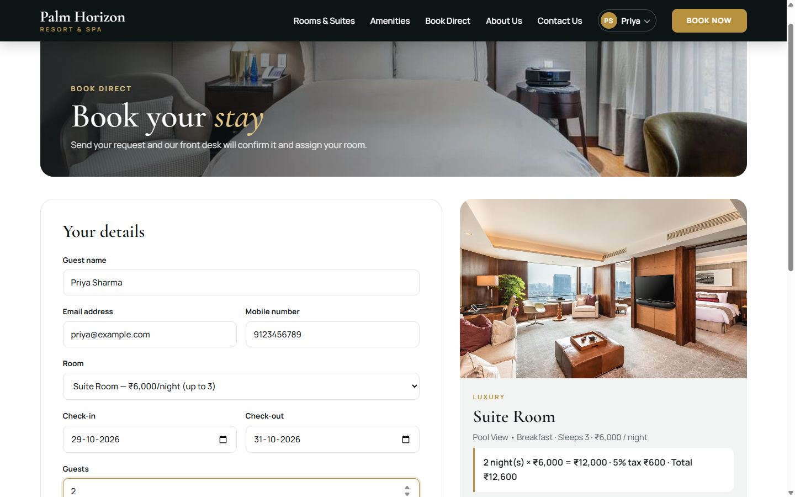
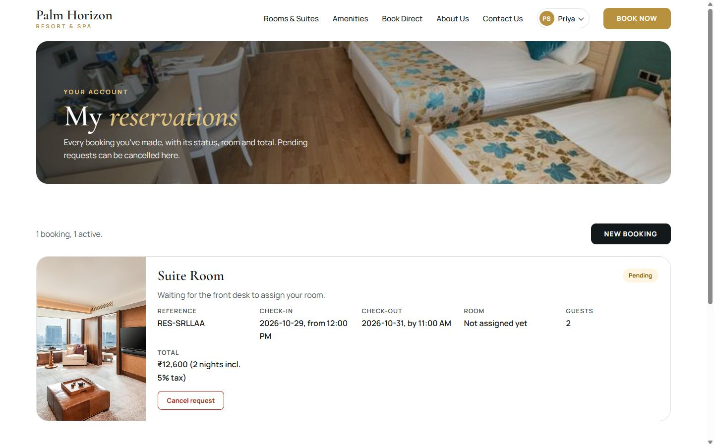
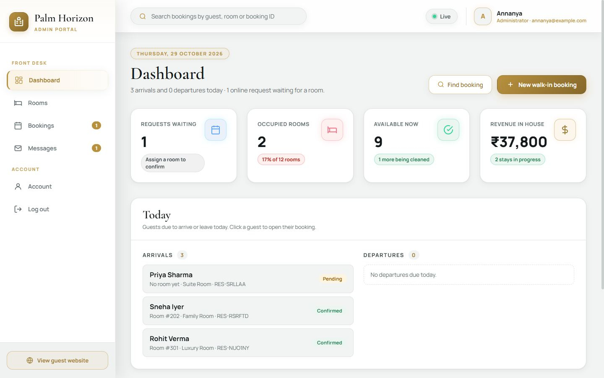
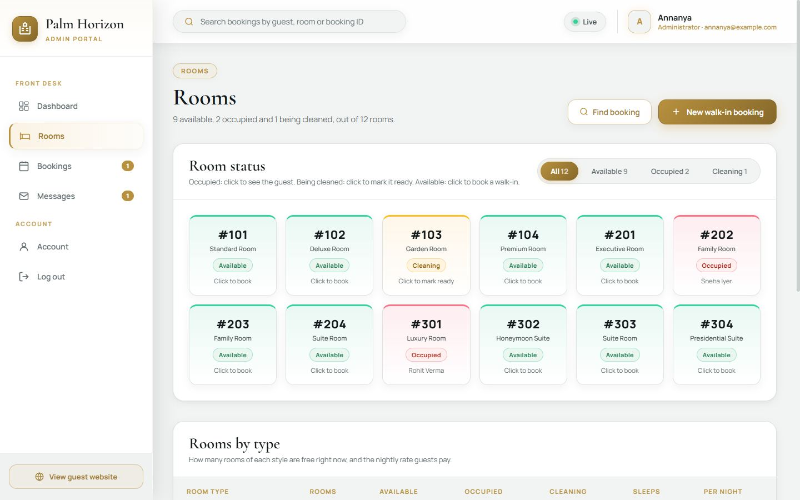
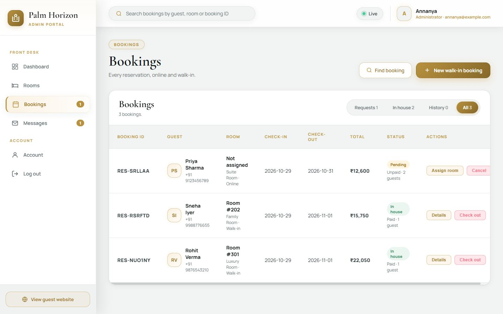
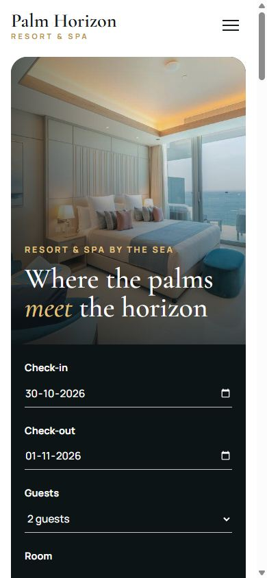

# Palm Horizon Resort & Spa — Hotel & Resort Management System

A web application for running a small hotel or resort. **Guests** browse rooms, create an account, request bookings and track them online. **Front-desk staff** use the **Admin portal** to see today's arrivals and departures, assign rooms to booking requests, take walk-in bookings, check guests out, manage housekeeping and answer messages.

**Live site:** https://palm-horizon-resort.onrender.com

Built with plain **HTML, CSS and JavaScript** (no framework, no build step), **Firebase Authentication** for sign-in and **Cloud Firestore** as the real-time database, and hosted on **Render**.



---

## Contents

1. [About the project](#about-the-project)
2. [Features](#features)
3. [Screenshots](#screenshots)
4. [Modules and team](#modules-and-team)
5. [Tech stack](#tech-stack)
6. [How it works](#how-it-works)
7. [Database design](#database-design)
8. [Security](#security)
9. [Project structure](#project-structure)
10. [Getting started](#getting-started)
11. [Deployment](#deployment)
12. [Configuration](#configuration)
13. [Testing](#testing)
14. [Branches and workflow](#branches-and-workflow)
15. [Limitations and future scope](#limitations-and-future-scope)

---

## About the project

**Problem.** Small hotels and resorts often take bookings by phone and track rooms on paper or spreadsheets. Guests can't see what's available or check the status of a request, and staff have no single view of who is arriving, which rooms are free and which need cleaning.

**Solution.** One website with two sides:

- **Guest website:** room catalogue with live availability, online booking with clear pricing, a personal "My reservations" page, and a contact form.
- **Admin portal:** a front-desk console that updates live as guests book, so staff always see the current state of every room and reservation.

**Objectives**

- Let guests find a room and request a booking in a few minutes, with the full price shown up front.
- Give staff a live view of rooms, bookings and messages, and make every front-desk task (assign, walk-in, check-out, housekeeping) a one- or two-click action.
- Keep data safe: guests see only their own bookings, prices can't be tampered with, and only admins can run the front desk.
- Run on free tiers (Firebase Spark plan and a Render static site) with no server to maintain.

---

## Features

### Guest website

| Page | What it does |
|---|---|
| **Home** (`index.html`) | Hero with a quick-booking bar (dates, guests, room), live "rooms free right now", rooms carousel, amenities |
| **Rooms & Suites** (`rooms.html`) | All 10 room styles with search, category filter, price sort and live availability badges |
| **Amenities** (`amenities.html`) | Every amenity, the rooms that have it, and a comparison table of all rooms |
| **Book Direct** (`book-direct.html`) | Booking benefits, the 5-step booking process and a worked price example |
| **About Us** (`about.html`) | The resort, every room floor by floor, how bookings are handled, and the team |
| **Contact Us** (`contact.html`) | Contact form (saved to the database and answered by staff) and booking FAQs |
| **Sign in / Create account** (`login.html`) | Email and password sign-in, sign-up and password reset |
| **Book your stay** (`booking.html`) | Booking form with validation, a live summary card and price estimate (5% tax) |
| **My reservations** (`reservations.html`) | The guest's bookings with status, room, dates and total; cancel pending requests |

Signed-in users get an **account menu** in the header (My reservations, Admin portal for admins, Log out).

### Admin portal (admins only)

| Page | What it does |
|---|---|
| **Dashboard** (`admin.html`) | Today's date, arrivals and departures, key numbers (requests waiting, occupancy, rooms available, revenue in house), and lists of requests, rooms being cleaned and new messages |
| **Rooms** (`admin-rooms.html`) | Live room grid with filters. Click an occupied room for its guest, a room being cleaned to mark it ready, or a free room to start a walk-in. Plus a "rooms by type" table |
| **Bookings** (`admin-bookings.html`) | Every booking in tabs (Requests, In house, History, All) with search, assign room, details, check-out and cancel |
| **Messages** (`admin-messages.html`) | Contact-form messages: reply by email, mark as handled |
| **Account** (`admin-account.html`) | Profile, change display name, password reset email, log out |

The sidebar shows live counts for requests waiting and new messages. The top-bar search finds bookings from any page. On phones the sidebar opens from a menu button.

---

## Screenshots

| Rooms & Suites | Sign in |
|---|---|
|  |  |

| Book your stay | My reservations |
|---|---|
|  |  |

| Admin portal: Dashboard | Admin portal: Rooms |
|---|---|
|  |  |

| Admin portal: Bookings | Phone |
|---|---|
|  |  |

---

## Modules and team

The project is split into four modules. Each was started on its own branch and merged into `main`.

| Module | Branch | Built by | Main files |
|---|---|---|---|
| **Admin** (front desk) | `feature/admin` | Krishna201i, Aman Mudgal (aman0723) | `admin*.html`, `js/admin/`, `css/admin.css` |
| **Rooms** | `feature/rooms` | Aman Saraswat | `rooms.html`, `amenities.html`, `js/rooms.js`, `css/rooms.css` |
| **Booking** | `feature/booking` | Amit Kumar | `booking.html`, `reservations.html`, `js/booking.js`, `css/booking.css` |
| **Authentication, database and integration** | `feature/auth` | annanya1606 | `login.html`, `js/auth.js`, `js/firebase.js`, `js/db.js`, `firestore.rules`, shared design system |

---

## Tech stack

| Layer | Technology |
|---|---|
| Front end | HTML5, CSS3, JavaScript (ES modules), no framework or build step |
| Fonts | Cormorant Garamond (headings) and Manrope (text) from Google Fonts |
| Authentication | Firebase Authentication (email and password) |
| Database | Cloud Firestore (real-time listeners, transactions, security rules) |
| Firebase SDK | v10.12.2, loaded from Google's CDN |
| Hosting | Render Static Site (auto-deploys from `main`); Firebase Hosting also supported |
| Local development | `serve` (static server) and the Firebase Emulator Suite |

---

## How it works

### Architecture

```
            ┌──────────────────────────┐
 Browser ── │  Render static site       │   serves public/ (HTML, CSS, JS, images)
            └──────────────────────────┘
    │
    │  Firebase JS SDK (in the browser)
    ├──────────► Firebase Authentication   sign in / sign up / password reset
    └──────────► Cloud Firestore           users, rooms, bookings, messages
                   └─ firestore.rules      who can read and write what
```

There is no custom server. Pages talk to Firebase directly, and the security rules in `firestore.rules` decide what each user may do.

### User roles

- **Guest:** every new account. Can book rooms, see and cancel their own pending requests, and send messages.
- **Admin:** set by changing the user's `role` to `admin` in Firestore. Can open the Admin portal and manage all rooms, bookings and messages.

### Booking lifecycle

```
Guest books online ──► Pending ──(admin assigns a room)──► Confirmed ──(check-out)──► CheckedOut
                         │                                     ▲                    room → cleaning
                         └──► Cancelled (guest or admin)       │                    (mark ready → available)
Admin walk-in booking ─────────────────────────────────────────┘
```

**Price** = nightly rate × nights, plus 5% tax. The same calculation is used on the booking page, in the admin portal and in the security rules.

---

## Database design

Cloud Firestore, four collections:

### `users/{uid}`

| Field | Type | Notes |
|---|---|---|
| `name` | string | Display name |
| `email` | string | Sign-in email |
| `role` | string | `guest` or `admin` |
| `createdAt` | timestamp | Set on sign-up |

### `rooms/{roomNo}`

| Field | Type | Notes |
|---|---|---|
| `roomNo` | string | `"101"` … `"304"` (first digit is the floor) |
| `typeId` | string | One of the 10 room styles in `public/js/data.js` |
| `status` | string | `available`, `occupied` or `cleaning` |

The 12 rooms are created automatically the first time an admin opens the portal.

### `bookings/{id}`

| Field | Type | Notes |
|---|---|---|
| `code` | string | Booking reference, e.g. `RES-4F2A9C` |
| `uid` | string | The guest's (or admin's, for walk-ins) user ID |
| `guestName`, `email`, `phone` | string | Guest details |
| `typeId` | string | Room style requested |
| `roomNo` | string or null | Assigned room; `null` while pending |
| `checkIn`, `checkOut` | string | `YYYY-MM-DD` |
| `guests`, `nights` | number | |
| `rate`, `subtotal`, `tax`, `total` | number | Price breakdown in ₹ |
| `status` | string | `Pending`, `Confirmed`, `CheckedOut` or `Cancelled` |
| `payment` | string | `Unpaid`, `Advance` or `Paid` |
| `source` | string | `online` or `walk-in` |
| `specialRequest` | string | Optional note from the guest |
| `createdAt` | timestamp | |

### `messages/{id}`

| Field | Type | Notes |
|---|---|---|
| `name`, `email`, `phone` | string | Sender details (phone optional) |
| `topic` | string | One of 5 topics |
| `bookingCode` | string | Optional booking reference |
| `message` | string | 10–2000 characters |
| `status` | string | `New` or `Handled` |
| `uid` | string or null | Set if the sender was signed in |
| `createdAt` | timestamp | |

---

## Security

All access is enforced by **`firestore.rules`** on Firebase's servers, not just in the browser:

- Guests can read only **their own** bookings and profile.
- Guests can create only **pending** requests for themselves, and the rules **recalculate the price**, so a tampered total is rejected.
- Guests can cancel only their own **pending** request, and change nothing else.
- **Nobody can make themselves an admin**; roles change only in the Firebase Console.
- Only admins can change rooms, confirm, check out or cancel any booking, and read messages.
- Anyone can send a contact message, but every field is validated (length, format, allowed topics).
- Room assignment and walk-ins use **Firestore transactions**, so two staff members can never give out the same room.
- All user-entered text is escaped before it's shown, so it can't inject HTML.

---

## Project structure

```
hotel-resort-and-management/
├── public/                     The website (everything here is published)
│   ├── index.html              Home
│   ├── rooms.html              Rooms & Suites
│   ├── amenities.html          Amenities and room comparison
│   ├── book-direct.html        Booking benefits, process and pricing
│   ├── about.html              About the resort and team
│   ├── contact.html            Contact form and FAQs
│   ├── login.html              Sign in / create account
│   ├── booking.html            Book your stay (sign-in required)
│   ├── reservations.html       My reservations (sign-in required)
│   ├── admin.html              Admin portal: Dashboard
│   ├── admin-rooms.html        Admin portal: Rooms
│   ├── admin-bookings.html     Admin portal: Bookings
│   ├── admin-messages.html     Admin portal: Messages
│   ├── admin-account.html      Admin portal: Account
│   ├── css/
│   │   ├── site.css            Shared design system (colours, fonts, header, footer, buttons, fields)
│   │   ├── home.css · rooms.css · pages.css · auth.css · booking.css
│   │   └── admin.css           Admin portal
│   ├── js/
│   │   ├── firebase-config.js  Firebase project settings
│   │   ├── firebase.js         Firebase initialisation (auth, db)
│   │   ├── auth.js             Sign in/up/out, roles, page guards, account menu
│   │   ├── db.js               All Firestore reads and writes
│   │   ├── data.js             Room catalogue, prices, inventory, amenities, contact details
│   │   ├── site.js             Shared header, menu and footer behaviour
│   │   ├── home.js · rooms.js · amenities.js · book-direct.js · about.js
│   │   ├── contact.js · login.js · booking.js · reservations.js
│   │   └── admin/
│   │       ├── shell.js        Admin login check, top bar, live data, sidebar counts
│   │       ├── modals.js       Walk-in, booking details, assign room, find booking
│   │       └── dashboard.js · rooms.js · bookings.js · messages.js · account.js
│   └── images/                 Room photos
├── docs/screenshots/           Screenshots used in this README
├── firestore.rules             Database security rules
├── firebase.json               Firebase Hosting and emulator settings
├── render.yaml                 Render deployment settings
├── serve.json                  Local server setting (used by npm start)
└── package.json                npm scripts: start, emulators, deploy
```

---

## Getting started

### Requirements

- [Node.js](https://nodejs.org) 18 or newer (only for the local web server and Firebase tools)
- [Git](https://git-scm.com)
- Java 11 or newer, only if you want to use the local Firebase emulators

> The pages use JavaScript modules, so open them **through a web server** (`npm start` or VS Code's *Live Server*). Double-clicking an `.html` file won't work.

### Run it locally

```bash
git clone https://github.com/aman0723/hotel-resort-and-management.git
cd hotel-resort-and-management
npm start
```

Open http://localhost:5000. This uses the shared Firebase project configured in `public/js/firebase-config.js`.

### Use your own Firebase project

1. At [console.firebase.google.com](https://console.firebase.google.com) click **Add project**.
2. **Build → Authentication → Get started → Sign-in method:** enable **Email/Password**.
3. **Build → Firestore Database → Create database** (production mode).
4. **Firestore → Rules:** paste the contents of `firestore.rules` and click **Publish**.
5. **Project settings → General → Your apps → Web (`</>`):** register an app and copy its `firebaseConfig` values into `public/js/firebase-config.js`.

### Use the local emulators (no Firebase account needed)

1. In `public/js/firebase-config.js` set `export const useEmulators = true;`
2. Run `npm run emulators` (needs Java). The emulator dashboard is at http://localhost:4000.
3. In a second terminal run `npm start` and open http://localhost:5000.

> Set `useEmulators` back to `false` before committing.

### Create the first admin

1. Sign up on `login.html` with the staff member's email.
2. In the Firebase Console open **Firestore → `users` →** that user's document.
3. Change `role` from `guest` to `admin`.
4. Log out and sign in again. Admins go straight to the **Admin portal** (`admin.html`), which is also linked from the account menu.

---

## Deployment

### Render (live site)

The site is a free **Render Static Site** that publishes the `public/` folder. Settings (also in `render.yaml`):

| Setting | Value |
|---|---|
| Branch | `main` |
| Build command | `echo "Static site, no build step"` |
| Publish directory | `public` |

Every push to `main` redeploys automatically. After a deploy, press **Ctrl + Shift + R** to make sure your browser isn't showing a cached version.

**After creating a new Render site**, add its domain (e.g. `palm-horizon-resort.onrender.com`) in **Firebase Console → Authentication → Settings → Authorized domains**.

**After changing `firestore.rules`**, publish them again in **Firebase Console → Firestore → Rules**. Render doesn't do this.

### Firebase Hosting (alternative)

```bash
npx firebase-tools login
npx firebase-tools use --add      # pick your project
npm run deploy                    # uploads public/ and firestore.rules
```

---

## Configuration

| What | Where |
|---|---|
| Firebase project settings | `public/js/firebase-config.js` |
| Resort phone, email and address (hidden while empty) | `RESORT_CONTACT` in `public/js/data.js` |
| Room styles, prices, capacities, photos | `ROOM_TYPES` in `public/js/data.js` |
| Room numbers and their styles | `DEFAULT_INVENTORY` in `public/js/data.js` |
| Amenity names and descriptions | `AMENITY_INFO` in `public/js/data.js` |
| Check-in and check-out times | `CHECK_IN_TIME`, `CHECK_OUT_TIME` in `public/js/data.js` |

> **Changing a price?** Update both `ROOM_TYPES` in `data.js` **and** the `roomRates()` map in `firestore.rules`, then publish the rules. The rules check prices on the server, so guest bookings are rejected until both match.

---

## Testing

Each feature was tested end to end in a browser against the Firebase emulators, at desktop and phone (390 px) widths:

- **Guest:** browse, filter and sort rooms; book from the home-page bar and the rooms page; validation errors; price and summary; My reservations; cancel a pending request; contact form while signed out.
- **Security:** direct database writes as a guest with a fake price, self-confirmation, another user's ID, self-promotion to admin, reading all bookings and editing rooms are all **denied** by the rules.
- **Admin:** room inventory created on first open; assign a room (requested style preselected); walk-in with live total; check-out → cleaning → mark ready; double-booking a room is blocked by the transaction; messages marked handled; display name change; top-bar search; sidebar counts.
- **Layout:** no horizontal scrolling on any page at phone width; keyboard navigation of the account menu and admin sidebar.

---

## Branches and workflow

The repository keeps five branches:

| Branch | Purpose |
|---|---|
| `main` | Live code. Render deploys from it |
| `feature/admin` | Admin module |
| `feature/rooms` | Rooms module |
| `feature/booking` | Booking module |
| `feature/auth` | Authentication, database and integration |

Changes go to a feature branch and reach `main` through a pull request.

---

## Limitations and future scope

- **Availability is "right now", not by date.** Rooms are occupied or free today; future dates aren't blocked yet. A next step is date-range availability so guests only see rooms free for their exact dates.
- **No online payment.** Payment is recorded by staff (`Paid`, `Advance`, `Unpaid`). Razorpay or Stripe could be added.
- **No automatic emails.** Guests see status changes on My reservations but aren't emailed. Firebase Cloud Functions could send confirmations.
- **Contact details** are hidden until real ones are added to `RESORT_CONTACT`.
- **Reports** (occupancy and revenue over time) and **multiple staff roles** (e.g. housekeeping vs. front desk) would be natural additions to the Admin portal.

---

*Palm Horizon Resort & Spa is a student hotel and resort management project.*
